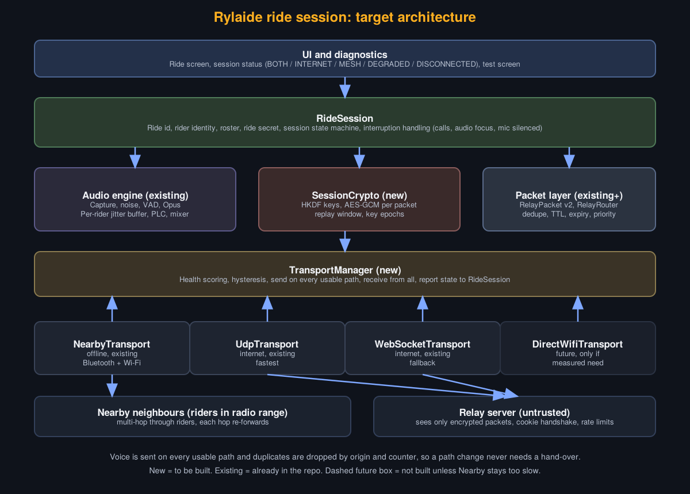
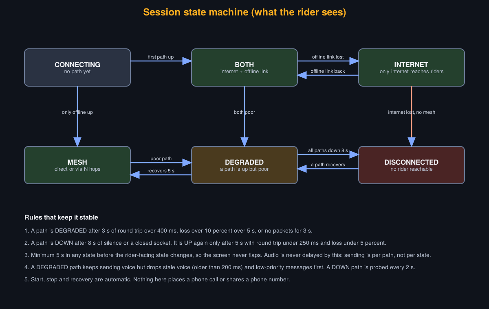

<p align="center">
  
</p>

<h1 align="center">Rylaide</h1>

<p align="center">
  <a href="https://github.com/Drakeion2532/Rylaide/actions/workflows/android-build.yml"></a>
  
  
  
</p>

**A free riding companion for motorcycle riders, built by a rider.**

Rylaide's core idea: riders talk to each other through the phones and headsets
they already own. No dedicated intercom hardware, no brand lock-in, and it works
with **no internet** when riders are close together. Around that intercom sit the
things a rider actually needs: navigation, trip tracking, a pre-ride checklist,
a fuel log, group rides and safety tools.

> **Status: early development.** The offline intercom works on test phones and
> the app is being built step by step. It is a test build, not ready for real
> rides or the Play Store yet.

## What it will do

- **Offline rider intercom** between phones using Google Nearby Connections
  (Bluetooth and Wi-Fi Direct, roughly 100 m), with an online fallback when
  riders spread out.
- **Any headset:** standard Bluetooth headsets or wired earphones. No special
  intercom unit needed.
- **Groups:** create or join by code or QR, group chat, ride plans, invites.
- **Navigation and trips:** free maps, turn-by-turn, ride recording and history.
- **Pre-ride checklist** that adapts to your vehicle, trip length and time of day.
- **Fuel log** with mileage and price trends.
- **Safety:** SOS, emergency contacts and crash alerts.
- **Your look:** light/dark themes, your own accent colour, Glove Mode with
  bigger touch targets.

## Tech stack

| Part | Choice |
|---|---|
| Android app | Kotlin, Jetpack Compose, Material 3 (native, Android first) |
| Offline voice | Google Nearby Connections |
| Online voice | LiveKit, self-hosted |
| Accounts, chat, sync | Firebase |
| Maps | MapLibre with OpenFreeMap tiles |
| Routing and search | OSRM and Nominatim |
| Weather | MET Norway |
| iOS | Swift and SwiftUI, planned after Android |

The aim is that running it costs nothing beyond the one-time Google Play
developer fee.

## Repository layout

```
android/       The Android app (Kotlin, Compose)
server/        Relay servers for the internet path (Node, UDP, Cloudflare Worker)
ios/           iOS app skeleton (not started)
prototypes/    Early experiments, kept for reference
docs/          Product brief, technical notes and design mockups
```

## Build progress

Legend: ✅ done and tested · 🟡 built, needs testing on phones · 🔵 partly built · ⬜ planned

**Overall (19 rows):** 3 done and tested, 2 built and waiting for phone tests, 4 partly built, 10 not started.

The full plan, with models, free-tier limits, store checklist and risks, is in
[`docs/build-plan.md`](docs/build-plan.md).

### Voice: the core

| # | Step | Status | Where it stands |
|:-:|---|:-:|---|
| 0 | Scaffold, theme, Home and in-ride screens | ✅ | Placeholder screens only. The app still opens to the test screen |
| 1 | Offline intercom, two phones, no internet | ✅ | Worked past 200 m on two phones |
| 2 | Better voice: Opus, jitter buffer, mixing, fast connect | ✅ | Connects in about 1 s, no lost packets outdoors, wired and Bluetooth switch automatically |
| 3 | Ride service, headset routing, noise test | 🟡 | Ride service, auto headset switching, mic-blocked alert, noise levels are in. Needs a long real ride and a Bluetooth headset test |
| 3b | Internet path, GPS distance, session state | 🟡 | UDP and WebSocket relay code, rider distances, session state line, transport layer (Build 22). No relay deployed, so the internet path has never run on phones |
| 3c | Encryption and authenticated riders | 🔵 | Packet encryption built and unit-tested. Not wired into the app yet |
| 10 | Online voice fallback | 🔵 | Same work as 3b: relay code exists, deployment and testing remain |

### App around the voice

| # | Step | Status | Where it stands |
|:-:|---|:-:|---|
| 4 | Foundation: API 36, design tokens, themes, Glove Mode | 🔵 | Themes and Glove Mode exist on placeholder screens. API 36 target still to do |
| 5 | Accounts and onboarding | ⬜ | |
| 6 | Garage, fuel log, pre-ride checklist | ⬜ | |
| 7 | Maps and solo rides | ⬜ | |
| 8 | Navigation | ⬜ | |
| 9 | Groups | ⬜ | |
| 11 | Safety and SOS | ⬜ | |
| 12 | Voice assistant | ⬜ | |
| 13 | Settings and languages | ⬜ | |

### Release

| # | Step | Status | Where it stands |
|:-:|---|:-:|---|
| 14 | Hardening, security, privacy | 🔵 | Encryption built (3c). Relay and Nearby authentication still to do |
| 15 | Testing with real riders | ⬜ | |
| 16 | Closed test and Play Store release | ⬜ | |

### How voice is being built

How the ride session, transports and rider-facing states fit together
([full design](docs/phase2-architecture.md)):





Voice is tap to talk, tap to mute (not hold to talk).

Every push to `main` runs an automatic Android build (see
`.github/workflows/android-build.yml`), so compile errors show up straight away.

## Try it on your phone

1. Open the [Actions page](https://github.com/Drakeion2532/Rylaide/actions), open the newest green run and download the **rylaide-debug-apk** artifact (a zip containing the `.apk`). Or open the `android` folder in Android Studio and run it.
2. Install on two Android phones (Android 8 or newer), same build on both.
3. On both: turn on Bluetooth, Wi-Fi and Location. Mobile data can be off.
4. Enter the same group code on both, tap Start, allow the permissions.
5. Tap the mic button on one phone and talk.

More detail is in [`android/SPRINT1.md`](android/SPRINT1.md).

## About

Rylaide is built by **Shubhan Punde**, a rider who wanted to talk to the people
he rides with using the phone and headset already in his pocket, without paying
for intercom hardware or an app subscription.

Principles the project follows:

- **Free for riders.** Running costs stay at zero apart from the one-time
  Google Play developer fee.
- **Honest about limits.** No "zero delay", no "unlimited range", no claim that
  wind noise is fully removed. Real measurements go in the docs.
- **Built in small steps.** Every piece is pushed to GitHub and built
  automatically, and tested on real phones before the next one starts.

## Contact and feedback

- Email: Relaide.com@gmail.com
- Instagram: [@rylaide_](https://instagram.com/rylaide_)

The project was previously called Relaide, so some older links and addresses
still use that name.

## License and use

No license has been chosen yet, so all rights are reserved (see [NOTICE](NOTICE)).
The code, name, logo and documents may not be copied, redistributed or used to train
AI or machine-learning models without written permission. Security and privacy rules:
[`docs/security-and-privacy.md`](docs/security-and-privacy.md).
