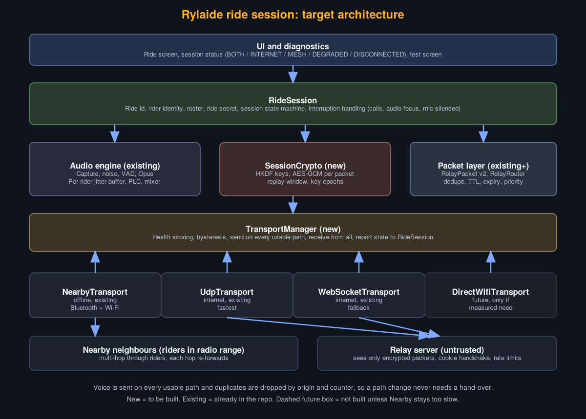
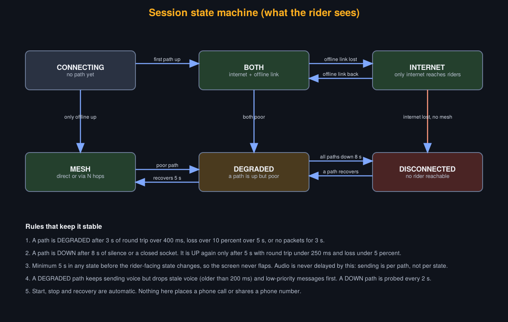

# Phase 2: adaptive communication architecture

Status: design only. No production code changes in this phase.




## 1. Four ways riders can talk, and what each can honestly do

| | Path | Works without internet | Status in repo | Decision |
|---|---|---|---|---|
| A | Internet voice (UDP relay, WebSocket fallback) | No (needs mobile data) | Built, tested in unit tests, never run on phones | Main long-range path |
| B | Cellular voice (SIM call) | Yes (needs signal) | Not built | Not an automatic path. See section 3 |
| C | Offline direct / mesh (Nearby Connections, multi-hop) | Yes | Built, tested on 2 phones | Main offline path |
| D | Unified ride session over A and C | Either | Partly (MeshDiscoveryManager does it implicitly) | Make it explicit |

## 2. Layers

1. **UI and diagnostics.** Shows one state word plus per-rider distance and path.
2. **RideSession.** Owns ride id, rider identities, roster, ride secret, the state machine, and interruptions (phone call, audio focus loss, mic silenced).
3. **Audio engine (exists).** Capture, noise, VAD, Opus, per-rider jitter buffer, PLC. It only sees "frames in, frames out", never a transport.
4. **SessionCrypto (new).** One ride secret shared by invite (QR or short code). HKDF derives audio, presence and relay-auth keys. AES-GCM per packet with a nonce built from origin id and counter. Replay window per origin. Key epoch byte so a key can change mid-ride.
5. **Packet layer (exists, extended).** RelayPacket v2 adds a version byte and a priority (voice, presence, position). RelayRouter keeps dedupe, TTL, drop-own-origin.
6. **TransportManager (new).** Sends every voice packet on every usable transport and receives from all. Duplicates die in RelayRouter. Because both paths carry the same packet, switching needs no hand-over and no audio gap.
7. **Transports.** A small interface: `send(bytes)`, `onReceive`, `health()`, `availability()`. Implementations: NearbyTransport, UdpTransport, WebSocketTransport (all wrap existing classes). DirectWifiTransport is a placeholder and is built only if measurements prove Nearby is too slow.

```kotlin
interface Transport {
    val name: String
    val state: StateFlow<TransportHealth>   // UP, DEGRADED, DOWN + rtt, loss, lastRx
    fun send(packet: ByteArray, priority: Priority)
    fun start(session: SessionConfig)
    fun stop()
    interface Listener { fun onPacket(bytes: ByteArray, from: Transport) }
}
```

## 3. Cellular voice (B): why it is not automatic

- Android has no public API that lets an app inject its own audio into a carrier call, or move a running internet call onto the carrier network.
- `TelecomManager.placeCall` can start a normal call, but it opens the system dialer, needs CALL_PHONE, and a call is one-to-one. A group needs a carrier conference service or a paid phone-number bridge, which breaks the zero-cost rule.
- VoLTE, VoNR and Wi-Fi Calling are carrier features. The app cannot rely on or select them.
- Mobile data on a SIM is already used by path A. That is how "SIM helps" in practice: the UDP relay over LTE.

Decision: no automatic cellular fallback. Optional later: a consented "Call rider" button that opens the dialer for a saved number. Voice quality of path A over LTE is improved by Phase 4 measurements, not by the carrier call stack.

## 4. Offline transport (C) and device matrix

Nearby Connections already picks Bluetooth, BLE, and Wi-Fi underneath. It delivers in order, so congestion becomes delay (seen 2 to 5 s with a Bluetooth headset, Build 17). Mitigation already in: congestion guard drops stale audio. Mitigation planned: measure first (Phase 4).

Device matrix to fill during testing (each row recorded by the test screen, so no guessing):

| Field | How collected |
|---|---|
| Model, Android version | Build.MODEL, SDK_INT |
| Google Play services version | PackageManager |
| `FEATURE_WIFI_AWARE`, `FEATURE_WIFI_DIRECT` | PackageManager.hasSystemFeature |
| Wi-Fi + Bluetooth coexistence | observed link RTT with headset on and off |
| Foreground service survives 30 min screen off | manual |
| Battery per hour | manual |

Test phones: Poco M2007J20CI (Android 12), realme RMX2001 (Android 11).

Wi-Fi Aware and raw Wi-Fi Direct are hardware and OEM dependent. They are not adopted until the matrix shows they exist on the target phones and the measurements show a gain.

## 5. Session state machine

States: CONNECTING, BOTH, INTERNET, MESH (direct or N hops), DEGRADED, DISCONNECTED.

- A path is DEGRADED after 3 s of round trip over 400 ms, loss over 10 percent over 5 s, or 3 s without packets.
- A path is DOWN after 8 s of silence or a closed socket. It is UP again only after 5 s with round trip under 250 ms and loss under 5 percent.
- The rider-facing state holds for at least 5 s, so the screen never flaps. Audio is not delayed by this because sending is per path.
- A DEGRADED path still carries voice but drops voice older than 200 ms and low-priority messages first. A DOWN path is probed every 2 s.
- All thresholds are starting values. They are tuned from logs in Phase 4.

## 6. Security (designed before the session layer is coded)

Today any phone that knows the group code is auto-accepted over Nearby, and the UDP relay answers any datagram, which allows reflection abuse. Fix:
- Ride secret created by the host, shared by QR or code. Group code is only a discovery hint, not a secret.
- Nearby: accept a connection only after a challenge-response using the ride key. Unknown endpoints are disconnected.
- Relay: join datagram carries a MAC over (ride id, timestamp). The server replies with a cookie; payload is accepted only with a valid cookie. No amplification because the reply is never larger than the request.
- Relay sees only AES-GCM ciphertext. Presence and positions are encrypted the same way.
- Limits stated honestly: a lost phone with the secret can join until the ride is ended; the relay can see who is connected and traffic volume.

## 7. Targets (unvalidated until Phase 6)

- Wired headset, riders close, offline: mouth-to-ear under 250 ms p95.
- Internet over LTE: under 350 ms p95.
- Path loss to audio resuming: under 5 s.
- No claim of "zero delay", "unlimited range", or full wind removal.

## 8. Risks

1. Nearby may stay too slow with a Bluetooth headset. Fallback: measure, then consider a Wi-Fi Direct transport behind the same interface.
2. Android 14 and Play target SDK rules limit foreground services started from the background.
3. Free relay hosting limits (Cloudflare counts messages; a VM needs an open UDP port).
4. OEM battery killers (Xiaomi, realme) stop the service.

## 9. Phase 3 to 5 plan (small commits)

1. `Transport` interface and adapters around existing links, with no behaviour change.
2. `TransportManager` with health scoring and a pure-Kotlin state machine plus unit tests using fake transports and a fake clock.
3. RelayPacket v2 and SessionCrypto with test vectors.
4. Nearby challenge-response and relay cookie handshake.
5. Rider-visible state and diagnostics on the test screen.
6. Measurement harness (loopback latency, jitter, loss, reconnect time), then tuning.
